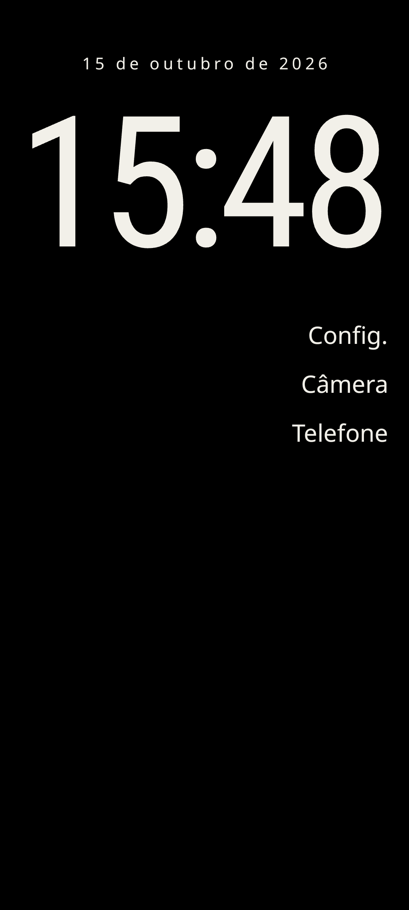
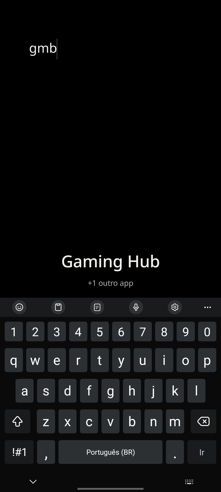
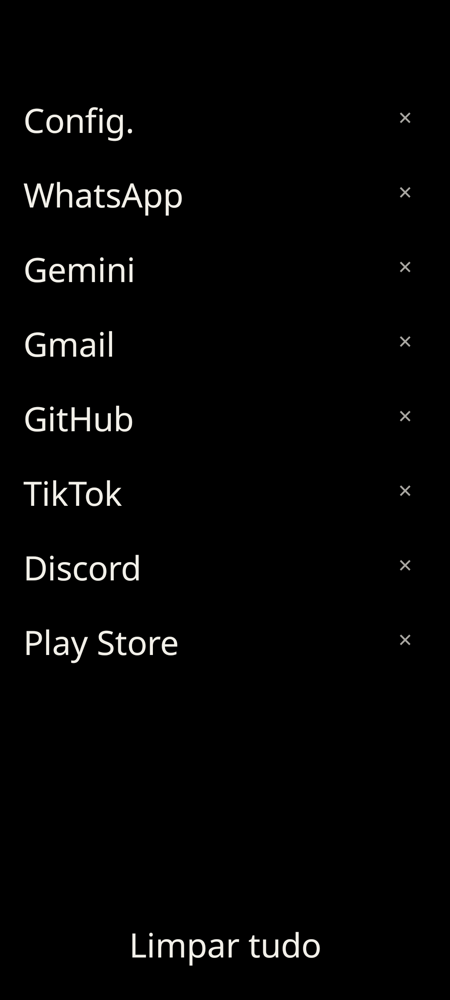

# Nothing Launcher

Launcher Android de tela única: sem ícones, sem widgets, sem páginas. Fundo sólido,
o relógio em cima, uma lista de favoritos embaixo. E uma tela à parte com os apps
abertos no sistema, só em texto.

Roda em Android 8.0 ou superior.

---

## Alpha. Leia isto antes de instalar

Isto é software de uso pessoal, em construção. Não está na Play Store e não tem
versão assinada.

O que isso significa na prática:

- **Foi testado em um aparelho só** — um Samsung com Android 13. Não há teste em
  outras marcas nem em outras versões do Android.
- **A tela de apps recentes depende do Shizuku** e de um comando de shell
  (`dumpsys`) cujo formato de saída não é uma API estável. Ela pode deixar de
  funcionar numa atualização de ROM. Não quebrou ainda, mas é o ponto mais frágil
  do app.
- **O Shizuku morre a cada reinício do aparelho** e precisa ser ligado de novo
  por ADB. Sem ele, a tela de recentes mostra um aviso e as outras duas telas
  funcionam normal.
- **Não há teste automático de interface.** São 20 testes de lógica pura (parser
  da lista, ranqueamento, guarda do "não se mate"). O resto — o visual, os gestos —
  foi verificado à mão em um aparelho, e é o que pode surprising te.

Se você perde o aparelho de vez por usar isso como launcher principal, não
instale ainda.

---

## Telas

**Inicial** — o relógio, a data e os favoritos.



**Busca** — o app que melhor responde ao texto, logo acima do teclado, e quantos
outros ficaram de fora. O ranqueamento aceita o nome pela metade: `gmb` acha
*Gaming Hub*, `tk` acha TikTok.



**Apps recentes** — os apps abertos no sistema, em texto, com um X por linha.



### As cores

São 11 combinações de fundo e texto, definidas em [`colors.md`](colors.md) e
[`searchScreen.md`](searchScreen.md). Trocar de cor é em *Configurações → Cor de
fundo*. O fundo da tela **é** a cor escolhida — não existe wallpaper.

As oito telas abaixo foram tiradas no aparelho de verdade. Uma ressalva: a combo
**11 (Preto OLED) só é preta à noite**. De dia o app troca o OLED por off-white
porque preto sob luz do sol é desconfortável — e de dia ela fica idêntica à 10.
Por isso as fotos da 11 são noturnas, e as da 10 são diurnas.

| Cor | Inicial | Busca | Recentes |
|---|---|---|---|
| 1. Creme + Marrom | [inicial](images/homescreen1.png) | [busca](images/searchScreen1.png) | [recentes](images/activitScreen1.png) |
| 2. Bege + Marrom escuro | [inicial](images/homescreen2.png) | [busca](images/searchScreen2.png) | [recentes](images/activitScreen2.png) |
| 3. Cinza claro + Grafite | [inicial](images/homescreen3.png) | [busca](images/searchScreen3.png) | [recentes](images/activitScreen3.png) |
| 4. Aço + Grafite frio | [inicial](images/homescreen4.png) | [busca](images/searchScreen4.png) | [recentes](images/activitScreen4.png) |
| 6. Areia + Marrom | [inicial](images/homescreen6.png) | [busca](images/searchScreen6.png) | [recentes](images/activitScreen6.png) |
| 9. Azul céu + Azul petróleo | [inicial](images/homescreen9.png) | [busca](images/searchScreen9.png) | [recentes](images/activitScreen9.png) |
| 10. Off-white + Preto suave | [inicial](images/homescreen10.png) | [busca](images/searchScreen10.png) | [recentes](images/activitScreen10.png) |
| 11. Preto OLED (padrão) | [inicial](images/homescreen11.png) | [busca](images/searchScreen11.png) | [recentes](images/activitScreen11.png) |

As prints se tiram de novo com `./shots.sh`, e `conferir_cores.py` mede a cor de
cada arquivo e compara com a paleta — um print de cor errada passaria batido.

---

## Para rodar

### O que precisa

| Item | Versão |
|---|---|
| JDK | 17 ou superior (o build foi feito com 27) |
| Android SDK | platform **android-37** e build-tools compatível |
| Gradle | 9.8 ou superior |

O repositório **não tem o `gradlew`**. Use o Gradle da sua máquina:

```bash
cd ~/Projects/launcher
gradle assembleDebug
# → app/build/outputs/apk/debug/app-debug.apk
```

Se o SDK não estiver no caminho padrão, crie/edite `local.properties` na raiz:

```properties
sdk.dir=/caminho/do/seu/Android/Sdk
```

### Instalar

```bash
adb install -r app/build/outputs/apk/debug/app-debug.apk
```

### Definir como launcher padrão

Pelo terminal:

```bash
adb shell cmd package set-home-activity com.minimal.launcher/.HomeActivity
```

Ou pelo aparelho: **Configurações → Apps → Apps padrão → App de início →
Nothing Launcher**.

---

## Shizuku: obrigatório para a tela de apps recentes

Um app comum não consegue ver os apps abertos no sistema. Android não dá essa
informação — nem para o launcher anterior, nem para o seu. O Shizuku empresta os
privilégios de shell do sistema para o app, e é com ele que a lista é montada.

**Sem Shizuku, nada quebra**: a tela inicial, a busca e as configurações funcionam
igual. A tela de recentes mostra um aviso explicando o que falta.

Como instalar:

1. Baixe o [Shizuku](https://github.com/RikkaApps/Shizuku/releases) (arquivo
   `.apk`) e instale.
2. **Ative a depuração por USB** (ou depuração sem fio, em *Opções do
   desenvolvedor*).
3.ligue o Shizuku por ADB. Sem wireless debugging, o caminho é o do APK
   `start.sh` que vem na mesma página de releases; com ele, é `adb shell` rodando
   o binário do próprio app instalado.
4. Abra o Shizuku, autorize o Nothing Launcher, e volte ao launcher.

O passo 3 muda conforme a versão do Shizuku e o Android. Se ele falhar, a saída do
comando costuma dizer por quê.

**Depois de reiniciar o aparelho, repita o passo 3.** O Shizuku não sobrevive ao
boot.

---

## Gestos

| Gesto | Resultado |
|---|---|
| Tocar no nome | Abre o app |
| Toque longo no nome | Favoritar, informações do app, desinstalar |
| Toque longo na área vazia | Abre a busca |
| Toque longo no relógio ou na data | Abre as configurações |
| Arrastar para cima, de baixo para cima | Abre a busca |
| Arrastar para o lado, da borda para dentro | Abre a tela de apps recentes |
| Arrastar para baixo | Fecha a tela de busca e a de recentes |
| Arrastar para o lado inverso, na tela de recentes | Fecha a tela |

O arrasto para o lado corre **na direção da sua mão dominante** (padrão: da
esquerda para a direita) e só vale quando **começa na faixa da borda**, uns 48dp.
No meio da tela ele não existe — ali é rolagem da lista. Percorre 10% da largura da
tela, o que dá um arrasto curto de polegar.

---

## O que ele pede ao sistema

Duas permissões, ambas no manifesto e nenhuma com diálogo:

| Permissão | Para quê |
|---|---|
| `QUERY_ALL_PACKAGES` | Ler a lista de apps instalados, para a busca e os favoritos |
| `moe.shizuku.manager.permission.API_V23` | Poder pedir autorização ao Shizuku |

Não pede acesso a notificações, não usa serviço de acessibilidade, não usa
serviço em segundo plano e não faz rede. Nada disso existe no app.

O launcher apenas esconde as barras do sistema e deixa você puxá-las quando
quiser; as notificações continuam funcionando como sempre.

---

## O que ele ainda não faz

- **Não substitui a tela de recents do Android.** A tela de recents mora dentro do
  SystemUI e não tem API pública para um app de terceiros substituir. Esta é uma
  tela à parte.
- **Não tem ícone, miniatura, imagem nem animação de transição.** Por projeto.
- **Não sabe de app aberto por notificação ou link** — a lista é a de apps com tela
  aberta, não histórico de uso.
- **O gesto do sistema não é substituído.** Trocar o gesto oficial de recents por
  este é o próximo alvo, e ainda não foi feito.
- **Sem build assinado.** `assembleRelease` precisa de uma chave que não está no
  repositório.

---

## Estrutura

```
app/src/main/java/com/minimal/launcher/
├── HomeActivity.java        tela inicial: relógio + favoritos
├── SearchActivity.java      busca
├── EdgeGestureLayout.java   resolve o conflito entre gesto e rolagem
├── ThemeHelper.java         cores, inversão noturna, insets
├── ColorCombo.java          as 11 combinações de cor
├── FontCombo.java           as 8 combinações de fonte
├── Prefs.java               preferências
├── apps/                    lista de apps, favoritos, busca
├── recents/                 tela de apps recentes (lista real, via Shizuku)
└── settings/                configurações
```

O porquê de cada decisão está em
[`docs/superpowers/specs/`](docs/superpowers/specs/). As notas técnicas de cada
armadilha encontrada estão em [`docs/notas-tecnicas.md`](docs/notas-tecnicas.md).

## Testes

```bash
gradle :app:testDebugUnitTest    # 20 testes de lógica pura
gradle :app:lintDebug            # análise estática
```

Os testes cobrem o parser da lista de apps abertos, a regra de dispensa por
instante e a guarda que impede o app de se encerrar. Não cobrem interface.